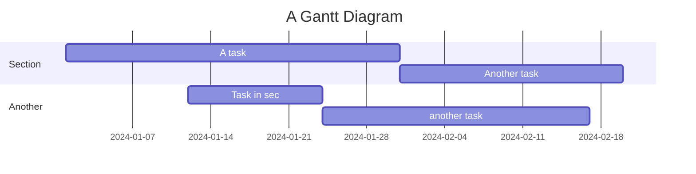
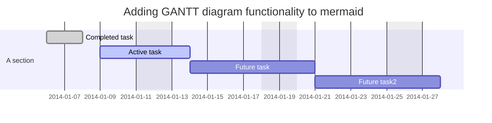

# Gantt diagrams

> A Gantt chart is a type of bar chart that illustrates a project schedule. It shows the dependency relationships between activities and the current schedule status.

Mermaid can render Gantt diagrams.

## Syntax

- Start with the `gantt` keyword.
- Optionally add a `title` line.
- Optionally set `dateFormat` (e.g. `YYYY-MM-DD`) to control how dates in task lines are parsed.
- Group tasks under `section <Section Name>` headers.
- Each task line follows: `Task name : [tag,] [id,] start, duration|end`.
  - `start` can be an explicit date, `after <taskId>`, or omitted to continue from the previous task.
  - `duration` is a number followed by a unit (`d` days, `w` weeks, `h` hours, `m` minutes).
  - Optional status tags before the id: `done`, `active`, `crit`, `milestone`.

