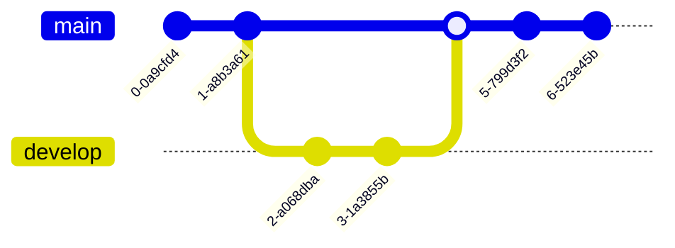
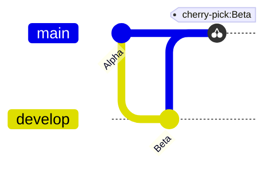

# Gitgraph (Git) Diagrams

> A Git Graph is a pictorial representation of git commits and git actions (branch, merge, etc.) on the various branches of a git repository.

Mermaid can render Git diagrams.

## Syntax

- Start the diagram with the `gitGraph` keyword.
- `commit` records a commit on the currently checked-out branch. Add an id or tag with `commit id: "..."` or `commit tag: "..."` if needed.
- `branch <name>` creates a new branch from the currently checked-out branch (does not switch to it).
- `checkout <name>` (or `switch <name>`) switches the currently active branch.
- `merge <name>` merges the named branch into the currently checked-out branch.
- `cherry-pick id: "<commitId>"` replays a specific commit onto the current branch.

